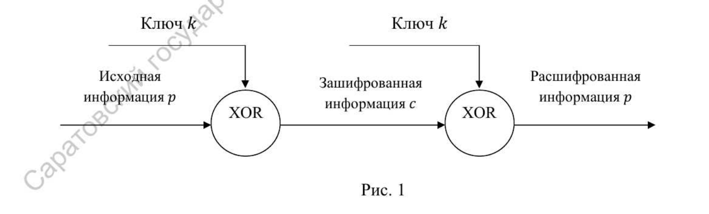
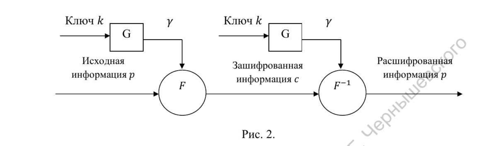

---
## Author
author:
  name: Мбах Наусси Джордан Вилфри
  degrees: BSc
  email: 1032265887@rudn.ru
  affiliation:
    - name: Российский университет дружбы народов им. П. Лумумбы
      country: Российская Федерация
      postal-code: 117198
      city: Москва
      address: ул. Миклухо-Маклая, д. 6
## Title
title: "Лабораторная работа 3"
subtitle: "Шифрование методом гаммирования"
license: CC BY
date: today
date-format: "YYYY-MM-DD"
---

# Информация

## Докладчик

:::::::::::::: {.columns align=center}
::: {.column width="70%"}

  * Мбах Наусси Джордан Вилфри
  * Студент 1 курса магистратуры
  * Группа НФИмд-01-26
  * Фундаментальная информатика и информационные технологии
  * Российский университет дружбы народов им. П. Лумумбы
  * [1032265887@rudn.ru](mailto:1032265887@rudn.ru)
  * <https://www.devjordan.com>

:::
::: {.column width="30%"}


:::
::::::::::::::

::: notes
- Поприветствовать аудиторию.
- Представиться кратко, даже если вас объявили.
:::

# Введение

## Цель работы

- Изучить схемы шифрования на основе побитового сложения по модулю два:
    - схему однократного использования (одноразовый блокнот);
    - схему гаммирования
- Реализовать на языке Python шифрование и расшифрование методом гаммирования
- Проверить корректность на контрольном примере

::: notes
- Сформулировать цель одним предложением.
- Обе схемы используют операцию XOR — её обратимость и лежит в основе симметричности.
:::

## Схема однократного использования

{width=85%}

- Отправитель складывает по модулю два сообщение $p$ и ключ $k$: $c_i = p_i \oplus k_i$
- Операция обратима: $(x \oplus y) \oplus y = x$, поэтому получатель повторно применяет XOR
- Недостаток: объём ключа равен суммарному объёму сообщений

::: notes
- Это схема Вернама (одноразовый блокнот).
- Теоретически абсолютно стойкая, но требует передачи огромного ключа.
:::

## Гаммирование

{width=85%}

- Ключ $k$ подаётся на генератор $G$ и порождает гамму — псевдослучайную последовательность
- Гамма накладывается на текст функцией $F$ (XOR или сложение по модулю $N$)
- ПСП детерминирована: известен алгоритм её формирования, но по свойствам она похожа на случайную

::: notes
- Именно так устраняется главный недостаток одноразового блокнота.
- Один короткий ключ порождает длинную последовательность.
:::

## Генератор ПСП и конечная гамма

- Простейший генератор — линейный конгруэнтный: $y_i = a\,y_{i-1} + b \pmod{m}$
- ПСП периодическая: при совпадении элементов совпадают и все последующие
- Максимальный период равен $m$ при условиях:
    - $b$ и $m$ взаимно просты;
    - $a - 1$ делится на любой простой делитель $m$;
    - $a - 1$ кратно $4$, если $m$ кратно $4$
- В роли конечной гаммы может выступать фраза, повторяемая циклически

::: notes
- Стойкость зависит от длины периода и равномерности распределения знаков гаммы.
- Знание периода облегчает криптоанализ.
:::

# Реализация

## Алфавит и вспомогательные функции

```{.python code-line-numbers="1-3|5-6|8-9"}
Alphabet = "абвгдежзийклмнопрстуфхцчшщъыьэюя"

N = len(Alphabet)

def to_number(text):
    return [Alphabet.index(char) + 1 for char in text.lower() if char in Alphabet]

def to_text(numbers):
    return "".join([Alphabet[number - 1] for number in numbers])
```

- Русский алфавит из 33 букв; позиции букв нумеруются от 1 до 33
- `to_number` — строка → последовательность номеров; `to_text` — обратное преобразование

::: notes
- Обе функции переиспользуются при шифровании и расшифровании.
:::

## Шифрование гаммой

```{.python code-line-numbers="4-5|7-11|13"}
def gamma_encrypt(text, key):
    plaintext = to_number(text)
    key = to_number(key)

    ciphertext = []

    for i in range(len(plaintext)):
        key_index = key[i % len(key)]  # gamma repeat if needed
        ciphertext.append((plaintext[i] + key_index - 1) % N + 1)

    return to_text(ciphertext)
```

- Гамма циклически повторяется над текстом: `key[i % len(key)]`
- Номера букв складываются по модулю длины алфавита: $c_i = (p_i + k_i) \bmod N$

::: notes
- Режим конечной гаммы: короткий ключ-фраза повторяется нужное число раз.
:::

## Расшифрование гаммой

```{.python}
def gamma_decrypt(text, key):
    ciphertext = to_number(text)
    key = to_number(key)

    plaintext = []

    for i in range(len(ciphertext)):
        key_index = key[i % len(key)]  # gamma repeat if needed
        plaintext.append((ciphertext[i] - key_index - 1) % N + 1)
    return to_text(plaintext)
```

- Расшифрование — вычитание той же гаммы: $p_i = (c_i - k_i) \bmod N$
- Симметричность относительно шифрования (сложение → вычитание)

::: notes
- Обратная операция восстанавливает текст без искажений.
:::

# Демонстрация

## Контрольный пример

{width=70%}

- Открытый текст: `ПРИКАЗ`, гамма: `ГАММА`
- Криптограмма: `усхчбл`
- Расшифровка: `приказ`

::: notes
- Номера букв: П=17, Р=18, И=10, К=12, А=1, З=9; Г=4, А=1, М=14.
- Пример полностью совпадает с расчётом из методических указаний.
:::

# Заключение

## Выводы

- Схема однократного использования абсолютно стойка, но требует ключ длиной с сообщение
- Гаммирование сокращает объём ключа: ключ порождает ПСП и повторяется циклически
- Реализованы прямое и обратное преобразования методом гаммирования на Python
- Корректность подтверждена: расшифровка `ПРИКАЗ` восстановлена из криптограммы `усхчбл`
- Стойкость гаммирования определяется длиной периода и равномерностью гаммы

::: notes
- Повторить главный вывод одним предложением.
- Готов ответить на вопросы.
:::
