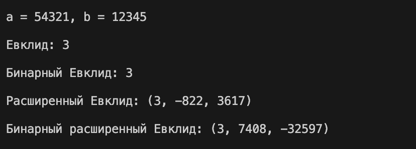
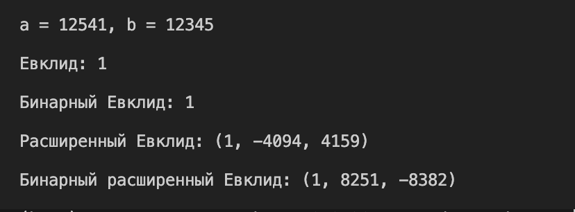

---
## Author
author:
  name: Мбах Наусси Джордан Вилфри
  degrees: BSc
  email: 1032265887@rudn.ru
  affiliation:
    - name: Российский университет дружбы народов им. П. Лумумбы
      country: Российская Федерация
      postal-code: 117198
      city: Москва
      address: ул. Миклухо-Маклая, д. 6
## Title
title: "Лабораторная работа 4"
subtitle: "Вычисление наибольшего общего делителя"
license: CC BY
date: today
date-format: "YYYY-MM-DD"
---

# Информация

## Докладчик

:::::::::::::: {.columns align=center}
::: {.column width="70%"}

  * Мбах Наусси Джордан Вилфри
  * Студент 1 курса магистратуры
  * Группа НФИмд-01-26
  * Фундаментальная информатика и информационные технологии
  * Российский университет дружбы народов им. П. Лумумбы
  * [1032265887@rudn.ru](mailto:1032265887@rudn.ru)
  * <https://www.devjordan.com>

:::
::: {.column width="30%"}


:::
::::::::::::::

::: notes
- Поприветствовать аудиторию.
- Представиться кратко, даже если вас объявили.
:::

# Введение

## Цель работы

- Изучить алгоритмы вычисления наибольшего общего делителя (НОД)
- Реализовать на языке Python:
    - алгоритм Евклида;
    - бинарный алгоритм Евклида;
    - расширенный алгоритм Евклида;
    - расширенный бинарный алгоритм Евклида
- Проверить корректность на контрольных примерах

::: notes
- Сформулировать цель одним предложением.
- НОД — основа для вычисления обратных элементов в криптографии.
:::

## Деление с остатком

- Для целых $a$ и $b \ne 0$: $a = qb + r$, где $q, r \in \mathbb{Z}$, $0 \le r < |b|$
- $q$ — неполное частное, $r$ — неполный остаток

::: notes
- Это основа всех алгоритмов лабораторной работы.
:::

## Наибольший общий делитель

- $d = \gcd(a_1, \dots, a_k)$, если:
    1. каждое $a_i$ делится на $d$;
    2. любой другой общий делитель $d'$ делит $d$
- Линейное представление: $d = x_1 a_1 + \dots + x_k a_k$
- Пример: $\gcd(91, 105, 154) = 7 = 7\cdot 91 + (-6)\cdot 105 + 0 \cdot 154$
- Взаимно простые: $\gcd(a, b) = 1$

::: notes
- Числа бывают взаимно простыми в совокупности и попарно взаимно простыми — это разные условия.
:::

# Алгоритмы

## Алгоритм Евклида

- Повторное деление с остатком: $r_{i-1} = q_i r_i + r_{i+1}$
- НОД — последний ненулевой остаток

```{.python}
def euclid(a, b):
    while b != 0:
        a, b = b , a%b
    return a
```

::: notes
- Классический алгоритм, число делений порядка $\log b$.
:::

## Бинарный алгоритм Евклида

- Опирается на свойства (при $0 < b \le a$):
    - оба чётные: $\gcd(a,b) = 2\gcd(a/2, b/2)$
    - $a$ нечётное, $b$ чётное: $\gcd(a,b) = \gcd(a, b/2)$
    - оба нечётные: $\gcd(a,b) = \gcd(a-b, b)$
- Нужны только сдвиги и вычитания, без деления

::: notes
- Удобен там, где деление — дорогая операция.
:::

## Расширенные алгоритмы

- Находят $d$ и коэффициенты $x, y$: $ax + by = d$
- Расширенный алгоритм Евклида:
  $x_{i+1} = x_{i-1} - q_i x_i$, $\; y_{i+1} = y_{i-1} - q_i y_i$
- Расширенный бинарный: поддерживает $A, B, C, D$ такие, что
  $u = Aa + Bb$, $v = Ca + Db$

::: notes
- Коэффициенты нужны для обратных элементов по модулю.
:::

# Реализация

## Бинарный алгоритм Евклида

```{.python code-line-numbers="2-5|6-13|14"}
def binary_euclid(a, b):
    g = 1
    while a % 2 == 0 and b % 2 == 0:
        a //= 2
        b //= 2
        g *= 2
    u, v = a, b
    while u != 0:
        while u % 2 == 0:
            u //= 2
        while v % 2 == 0:
            v //= 2
        if u >= v:
            u = u-v
        else:
            v = v-u
    return g * v
```

::: notes
- Сначала выносим общую степень двойки в $g$, затем работаем с нечётными частями.
:::

## Расширенный алгоритм Евклида

```{.python code-line-numbers="2-3|4-7|8"}
def extended_euclid(a, b):
    x0, x1 = 1, 0
    y0, y1 = 0, 1
    while b != 0:
        q = a // b
        a, b = b, a - q * b
        x0, x1 = x1, x0 - q * x1
        y0, y1 = y1, y0 - q * y1
    return a , x0, y0
```

::: notes
- Инвариант: на каждом шаге остаток равен $a x + b y$ для текущих коэффициентов.
:::

## Расширенный бинарный алгоритм Евклида (1/2)

```{.python code-line-numbers="9-17|18-24|25-33"}
def binary_extended_euclid(a, b):
    a0, b0 = a, b
    g = 1
    while a % 2 == 0 and b % 2 == 0:
        a //= 2
        b //= 2
        g *= 2
    u , v = a, b
    A, B, C, D = 1, 0, 0, 1
    while u != 0:
        while u % 2 == 0:
            u //= 2
            if A % 2 == 0 and B % 2 == 0:
                A //= 2
                B //= 2
            else:
                A = (A + b) // 2
                B = (B - a) // 2
        
```

::: notes
- Деление на 2 коэффициентов возможно, так как при нечётных $A, B$ прибавляем $b$ и вычитаем $a$ — сумма становится чётной.
:::

## Расширенный бинарный алгоритм Евклида (2/2)

```{.python code-line-numbers="9-17|18-24|25-33"}
        while v % 2 == 0:
            v //= 2
            if C % 2 == 0 and D % 2 == 0:
                C //= 2
                D //= 2
            else:
                C = (C + b) // 2
                D = (D - a) // 2
        if u >= v:
            u -= v
            A -= C
            B -= D
        else:
            v -=u
            C -=A
            D -= B
    return g * v, C, D
```

::: notes
- Деление на 2 коэффициентов возможно, так как при нечётных $A, B$ прибавляем $b$ и вычитаем $a$ — сумма становится чётной.
:::

# Демонстрация

## Контрольные примеры

```{.python}
tests = [(24690, 12345), (54321, 12345), (12541, 12345)]
```

| $a$ | $b$ | $\gcd(a,b)$ |
|:---:|:---:|:---:|
| 24690 | 12345 | 12345 |
| 54321 | 12345 | 3 |
| 12541 | 12345 | 1 |

::: notes
- Четыре алгоритма на каждом тесте дают одинаковый НОД.
- Третья пара взаимно простая.
:::

## Результаты работы программы

::: {.columns}
::: {.column width="33%"}
{width=100%}
:::
::: {.column width="33%"}
{width=100%}
:::
::: {.column width="33%"}
{width=100%}
:::
:::

::: notes
- Кратко описать, что показывает каждый скриншот: ввод, четыре результата.
:::

## Линейное представление НОД

| $a$ | $b$ | $d$ | Расш. Евклид $(x, y)$ | Расш. бинарный $(x, y)$ |
|:---:|:---:|:---:|:---:|:---:|
| 24690 | 12345 | 12345 | $(0,\ 1)$ | $(0,\ 1)$ |
| 54321 | 12345 | 3 | $(-822,\ 3617)$ | $(7408,\ -32597)$ |
| 12541 | 12345 | 1 | $(-4094,\ 4159)$ | $(8251,\ -8382)$ |

- Проверка: $54321\cdot(-822) + 12345\cdot 3617 = 3$
- Коэффициенты определены неоднозначно, оба набора верны

::: notes
- Разные алгоритмы дают разные, но одинаково корректные пары $(x, y)$.
:::

# Заключение

## Выводы

- Реализованы четыре алгоритма вычисления НОД на Python
- Все алгоритмы дают одинаковый НОД на трёх контрольных примерах
- Бинарный алгоритм заменяет деление сдвигами и вычитанием
- Расширенные алгоритмы дают линейное представление $d = ax + by$, необходимое для обратных элементов в криптографии

::: notes
- Повторить главный вывод одним предложением.
- Готов ответить на вопросы.
:::