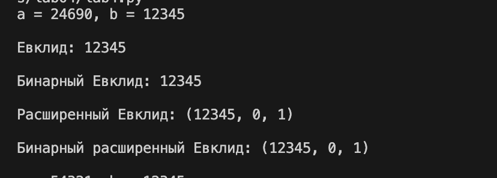

---
## Author
author:
  name: Мбах Наусси Джордан Вилфри
  degrees: BSc
  email: 1032265887@rudn.ru
  affiliation:
    - name: Российский университет дружбы народов им. П. Лумумбы
      country: Российская Федерация
      postal-code: 117198
      city: Москва
      address: ул. Миклухо-Маклая, д. 6
## Title
title: "Отчёт по лабораторной работе №4"
subtitle: "Вычисление наибольшего общего делителя"
license: "CC BY"
abstract: |
  В работе изучены и реализованы на языке Python алгоритмы вычисления наибольшего общего делителя (НОД): алгоритм Евклида, бинарный алгоритм Евклида, расширенный алгоритм Евклида и расширенный бинарный алгоритм Евклида. Корректность реализации проверена на трёх контрольных примерах.
keywords: ["лабораторная работа", "НОД", "алгоритм Евклида", "бинарный алгоритм", "расширенный алгоритм Евклида"]
---

# Цель работы

Изучить алгоритмы вычисления наибольшего общего делителя двух целых чисел и реализовать их программно.

# Задание

1. Реализовать алгоритм Евклида.
2. Реализовать бинарный алгоритм Евклида.
3. Реализовать расширенный алгоритм Евклида.
4. Реализовать расширенный бинарный алгоритм Евклида.
5. Проверить результаты на контрольных примерах.

# Теоретическое введение

## Деление с остатком

Пусть $a, b \in \mathbb{Z}$, $b \neq 0$. Разделить $a$ на $b$ с остатком — значит представить $a = qb + r$, где $q, r \in \mathbb{Z}$, $0 \le r < |b|$. Число $q$ называется неполным частным, $r$ — неполным остатком.

## Наибольший общий делитель

Целое число $d \neq 0$ называется наибольшим общим делителем чисел $a_1, \dots, a_k$ ($d = \gcd(a_1, \dots, a_k)$), если:

1. каждое из чисел $a_1, \dots, a_k$ делится на $d$;
2. если $d' \neq 0$ — другой общий делитель этих чисел, то $d$ делится на $d'$.

НОД можно представить в виде линейной комбинации. Например, $\gcd(91, 105, 154) = 7$, и
$$7 = 7 \cdot 91 + (-6) \cdot 105 + 0 \cdot 154.$$

Числа $a_1, \dots, a_k$ называются *взаимно простыми в совокупности*, если $\gcd(a_1, \dots, a_k) = 1$, и *попарно взаимно простыми*, если $\gcd(a_i, a_j) = 1$ для всех $i \neq j$. Числа $a$ и $b$ взаимно просты, если $\gcd(a, b) = 1$.

## Алгоритм Евклида

Основан на повторном делении с остатком: $r_{i-1} = q_i r_i + r_{i+1}$. Последний ненулевой остаток равен $\gcd(a, b)$.

## Бинарный алгоритм Евклида

Основан на свойствах НОД (при $0 < b \le a$):

1. если $a$ и $b$ чётные, то $\gcd(a, b) = 2\gcd(a/2, b/2)$;
2. если $a$ нечётное, $b$ чётное, то $\gcd(a, b) = \gcd(a, b/2)$;
3. если $a$ и $b$ нечётные, $a > b$, то $\gcd(a, b) = \gcd(a - b, b)$;
4. если $a = b$, то $\gcd(a, b) = a$.

**Алгоритм.** Вход: $a, b$, $0 < b \le a$. Выход: $d = \gcd(a, b)$.

1. $g \leftarrow 1$.
2. Пока $a$ и $b$ чётные: $a \leftarrow a/2$, $b \leftarrow b/2$, $g \leftarrow 2g$.
3. $u \leftarrow a$, $v \leftarrow b$.
4. Пока $u \neq 0$:
    1. пока $u$ чётное, $u \leftarrow u/2$;
    2. пока $v$ чётное, $v \leftarrow v/2$;
    3. если $u \ge v$, то $u \leftarrow u - v$, иначе $v \leftarrow v - u$.
5. $d \leftarrow g v$.

## Расширенный алгоритм Евклида

Находит $d = \gcd(a, b)$ и такие $x, y$, что $ax + by = d$.

1. $r_0 \leftarrow a$, $r_1 \leftarrow b$, $x_0 \leftarrow 1$, $x_1 \leftarrow 0$, $y_0 \leftarrow 0$, $y_1 \leftarrow 1$, $i \leftarrow 1$.
2. Разделить с остатком: $r_{i-1} = q_i r_i + r_{i+1}$.
3. Если $r_{i+1} = 0$, то $d \leftarrow r_i$, $x \leftarrow x_i$, $y \leftarrow y_i$. Иначе $x_{i+1} = x_{i-1} - q_i x_i$, $y_{i+1} = y_{i-1} - q_i y_i$, $i \leftarrow i + 1$ и вернуться к шагу 2.

## Расширенный бинарный алгоритм Евклида

1. $g \leftarrow 1$.
2. Пока $a$ и $b$ чётные: $a \leftarrow a/2$, $b \leftarrow b/2$, $g \leftarrow 2g$.
3. $u \leftarrow a$, $v \leftarrow b$, $A \leftarrow 1$, $B \leftarrow 0$, $C \leftarrow 0$, $D \leftarrow 1$.
4. Пока $u \neq 0$:
    1. пока $u$ чётное: $u \leftarrow u/2$; если $A$ и $B$ чётные, то $A \leftarrow A/2$, $B \leftarrow B/2$, иначе $A \leftarrow (A + b)/2$, $B \leftarrow (B - a)/2$;
    2. пока $v$ чётное: $v \leftarrow v/2$; если $C$ и $D$ чётные, то $C \leftarrow C/2$, $D \leftarrow D/2$, иначе $C \leftarrow (C + b)/2$, $D \leftarrow (D - a)/2$;
    3. если $u \ge v$, то $u \leftarrow u - v$, $A \leftarrow A - C$, $B \leftarrow B - D$; иначе $v \leftarrow v - u$, $C \leftarrow C - A$, $D \leftarrow D - B$.
5. $d \leftarrow g v$, $x \leftarrow C$, $y \leftarrow D$.

# Выполнение лабораторной работы

Алгоритмы реализованы на языке Python (файл `lab04.py`).

```python
# Алгоритм Евклида.
def euclid(a, b):
    while b != 0:
        a, b = b , a%b
    return a

# Бинарный алгоритм Евклида.
def binary_euclid(a, b):
    g = 1
    while a % 2 == 0 and b % 2 == 0:
        a //= 2
        b //= 2
        g *= 2
    u, v = a, b
    while u != 0:
        while u % 2 == 0:
            u //= 2
        while v % 2 == 0:
            v //= 2
        if u >= v:
            u = u-v
        else:
            v = v-u
    return g * v


# Расширенный алгоритм Евклида.
def extended_euclid(a, b):
    x0, x1 = 1, 0
    y0, y1 = 0, 1
    while b != 0:
        q = a // b
        a, b = b, a - q * b
        x0, x1 = x1, x0 - q * x1
        y0, y1 = y1, y0 - q * y1
    return a , x0, y0

# Расширенный бинарный алгоритм Евклида.
def binary_extended_euclid(a, b):
    a0, b0 = a, b
    g = 1
    while a % 2 == 0 and b % 2 == 0:
        a //= 2
        b //= 2
        g *= 2
    u , v = a, b
    A, B, C, D = 1, 0, 0, 1
    while u != 0:
        while u % 2 == 0:
            u //= 2
            if A % 2 == 0 and B % 2 == 0:
                A //= 2
                B //= 2
            else:
                A = (A + b) // 2
                B = (B - a) // 2
        while v % 2 == 0:
            v //= 2
            if C % 2 == 0 and D % 2 == 0:
                C //= 2
                D //= 2
            else:
                C = (C + b) // 2
                D = (D - a) // 2
        if u >= v:
            u -= v
            A -= C
            B -= D
        else:
            v -=u
            C -=A
            D -= B
    return g * v, C, D


tests = [(24690, 12345), (54321, 12345), (12541, 12345)]

for a, b in tests:
    print(f"a = {a}, b = {b}")
    
    print("\nЕвклид:", euclid(a, b))
    
    print("\nБинарный Евклид:", binary_euclid(a, b))
    print("\nРасширенный Евклид:", extended_euclid(a, b))
    print("\nБинарный расширенный Евклид:", binary_extended_euclid(a, b))
    print()
```

Функции принимают два целых числа $a \ge b > 0$; расширенные версии возвращают тройку $(d, x, y)$. В основной части программы алгоритмы последовательно запускаются на трёх парах чисел.

# Результаты

Программа была запущена на трёх парах чисел: $(24690, 12345)$, $(54321, 12345)$ и $(12541, 12345)$. Результаты работы показаны на рис. [-@fig-result1], [-@fig-result2] и [-@fig-result3].

{#fig-result1 width=80%}

{#fig-result2 width=80%}

{#fig-result3 width=80%}

Сводные результаты:

| $a$ | $b$ | $\gcd(a,b)$ | Расширенный Евклид $(d, x, y)$ | Расширенный бинарный $(d, x, y)$ |
|:---:|:---:|:---:|:---:|:---:|
| 24690 | 12345 | 12345 | $(12345,\ 0,\ 1)$ | $(12345,\ 0,\ 1)$ |
| 54321 | 12345 | 3 | $(3,\ -822,\ 3617)$ | $(3,\ 7408,\ -32597)$ |
| 12541 | 12345 | 1 | $(1,\ -4094,\ 4159)$ | $(1,\ 8251,\ -8382)$ |

Все четыре алгоритма дали одинаковое значение НОД для каждой пары. Корректность линейного представления $d = ax + by$ проверена подстановкой:

- $24690 \cdot 0 + 12345 \cdot 1 = 12345$;
- $54321 \cdot (-822) + 12345 \cdot 3617 = 3$ и $54321 \cdot 7408 + 12345 \cdot (-32597) = 3$;
- $12541 \cdot (-4094) + 12345 \cdot 4159 = 1$ и $12541 \cdot 8251 + 12345 \cdot (-8382) = 1$.

Расширенные алгоритмы дали разные пары $(x, y)$ для одной и той же пары $(a, b)$. Это ожидаемо: коэффициенты Безу определены неоднозначно, если $\gcd(a, b)$ не равен $\max(a,b)$ в тривиальных случаях. Пара $(12541, 12345)$ взаимно простая, так как $\gcd = 1$.

# Выводы

В ходе лабораторной работы были изучены и реализованы на Python четыре алгоритма вычисления наибольшего общего делителя. Все реализации дали одинаковое значение НОД на трёх контрольных примерах: $\gcd(24690, 12345) = 12345$, $\gcd(54321, 12345) = 3$, $\gcd(12541, 12345) = 1$. Бинарный алгоритм использует только сдвиги и вычитания, а расширенные алгоритмы дополнительно дают линейное представление $d = ax + by$, которое необходимо для нахождения обратных элементов по модулю в криптографических задачах.

# Список литературы {.unnumbered}

::: {#refs}
:::