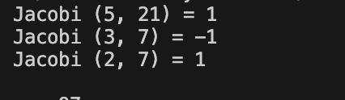
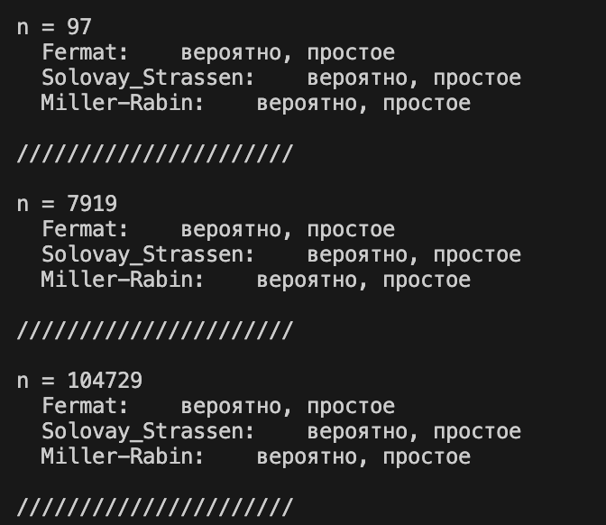
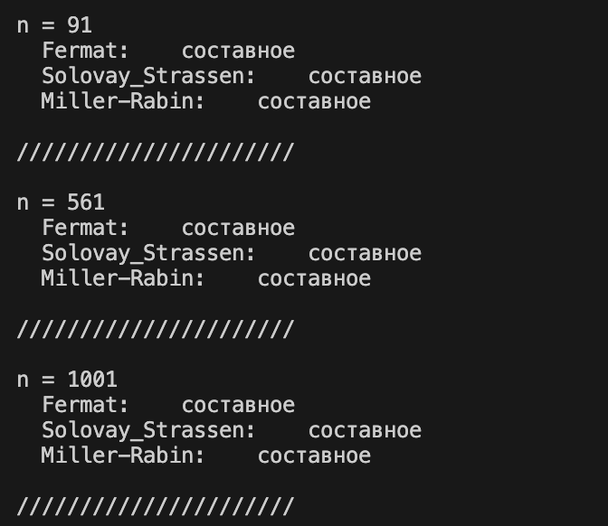

---
## Author
author:
  name: Мбах Наусси Джордан Вилфри
  degrees: BSc
  email: 1032265887@rudn.ru
  affiliation:
    - name: Российский университет дружбы народов им. П. Лумумбы
      country: Российская Федерация
      postal-code: 117198
      city: Москва
      address: ул. Миклухо-Маклая, д. 6
## Title
title: "Лабораторная работа 5"
subtitle: "Вероятностные алгоритмы проверки чисел на простоту"
license: CC BY
date: today
date-format: "YYYY-MM-DD"
---

# Информация

## Докладчик

:::::::::::::: {.columns align=center}
::: {.column width="70%"}

  * Мбах Наусси Джордан Вилфри
  * Студент 1 курса магистратуры
  * Группа НФИмд-01-26
  * Фундаментальная информатика и информационные технологии
  * Российский университет дружбы народов им. П. Лумумбы
  * [1032265887@rudn.ru](mailto:1032265887@rudn.ru)
  * <https://www.devjordan.com>

:::
::: {.column width="30%"}


:::
::::::::::::::

::: notes
- Поприветствовать аудиторию.
- Представиться кратко, даже если вас объявили.
:::

# Введение

## Цель работы

- Изучить вероятностные алгоритмы проверки чисел на простоту
- Реализовать на языке Python:
    - тест Ферма;
    - алгоритм вычисления символа Якоби;
    - тест Соловэя–Штрассена;
    - тест Миллера–Рабина
- Проверить на простых и составных числах

::: notes
- Сформулировать цель одним предложением.
- Проверка на простоту — часть генерации ключей в криптографии с открытым ключом.
:::

## Простые и составные числа

- Простое $p$: нет делителей, кроме тривиальных $\pm 1, \pm p$
- Иначе число составное
- $a \equiv b \pmod m$, если $m \mid (a - b)$
- Применение: генерация простых чисел в криптографии с открытым ключом

::: notes
- Примеры простых: 2, 3, 5, 7, 11, 13, 17, 19, 23, 29.
:::

## Вероятностные алгоритмы

- Выбирается случайное $a$, $1 < a < n$, проверяется условие теста
- Не прошёл тест → $n$ **точно** составное
- Прошёл тест → $n$ «вероятно, простое»
- После $t$ независимых запусков вероятность ошибки $\le \dfrac{1}{2^t}$

::: notes
- Ответ «составное» достоверен всегда, ответ «простое» — только с вероятностью.
- При t = 10 ошибка меньше 0,1 %.
:::

## Схема вероятностного теста

```{mermaid}
%%| fig-width: 100%
graph TD
    A[Выбрать случайное a, 1 < a < n] --> B{Условие теста}
    B -->|Пройден| C[n, вероятно, простое]
    B -->|Не пройден| D[n составное]
```

::: notes
- Общая схема для всех трёх тестов, отличается только условие.
:::

# Теория

## Тест Ферма

- Малая теорема Ферма: $a^{p-1} \equiv 1 \pmod p$ для простого $p$
- Если $a^{n-1} \not\equiv 1 \pmod n$, то $n$ составное
- Алгоритм:
    1. $a \in [2, n-2]$
    2. $r \leftarrow a^{n-1} \bmod n$
    3. $r = 1$ → «вероятно, простое», иначе «составное»
- Слабость: числа Кармайкла (например, $561$)

::: notes
- a = 1 и a = n−1 не берём: для них условие выполняется всегда.
:::

## Символ Якоби

- $n = p_1 p_2 \dots p_r$, $p_i \ne 2$:
  $\left(\dfrac{m}{n}\right) = \left(\dfrac{m}{p_1}\right)\dots\left(\dfrac{m}{p_r}\right)$
- Вычисление: $a = 2^k a_1$, $a_1$ нечётное
    - $k$ чётное → $s = 1$
    - $k$ нечётное: $s = 1$ при $n \equiv \pm 1 \pmod 8$, иначе $s = -1$
    - $n \equiv a_1 \equiv 3 \pmod 4$ → $s \leftarrow -s$
- Далее: $a \leftarrow n \bmod a_1$, $n \leftarrow a_1$, $g \leftarrow g \cdot s$

::: notes
- Это квадратичный закон взаимности и свойство множителя 2.
:::

## Тест Соловэя–Штрассена

- Критерий Эйлера: $a^{\frac{n-1}{2}} \equiv \left(\dfrac{a}{n}\right) \pmod n$
- Алгоритм:
    1. $a \in [2, n-2]$, $r \leftarrow a^{(n-1)/2} \bmod n$
    2. $r \ne 1$ и $r \ne n-1$ → «составное»
    3. $s \leftarrow \left(\dfrac{a}{n}\right)$
    4. $r \not\equiv s \pmod n$ → «составное», иначе «вероятно, простое»

::: notes
- Для составного n лжесвидетелей не больше половины.
:::

## Тест Миллера–Рабина

- $n - 1 = 2^s r$, $r$ нечётное
- $y \leftarrow a^r \bmod n$
- Если $y \ne \pm 1$: возводим в квадрат до $s - 1$ раз
    - $y = 1$ → «составное»
    - $y = n - 1$ → «вероятно, простое»
- Не достигли $n - 1$ → «составное»

::: notes
- Самый употребительный тест на практике.
- Лжесвидетелей для составного n не более четверти.
:::

# Реализация

## Тест Ферма

```{.python code-line-numbers="2|3|4-6"}
def fermat_test(n):
    a = random.randint(2, n-2)
    r = pow(a, n - 1, n)
    if r == 1:
        return "вероятно, простое"
    return "составное"
```

::: notes
- pow с тремя аргументами — быстрое возведение в степень по модулю.
:::

## Символ Якоби (1/2)

```{.python code-line-numbers="2-5|7-11|13-18"}
def jacobi(a, n):
    g = 1
    while True:
        if a == 0:
            return 0
        if a == 1:
            return g

        k = 0
        a1 = a
        while a1 % 2 == 0:
            a1 //= 2
            k += 1

        if k % 2 == 0:
            s = 1
        elif n % 8 in (1, 7):
            s = 1
        else:
            s = -1
```

::: notes
- Выделяем степень двойки: a = 2^k * a1.
- Знак s зависит от чётности k и от n по модулю 8.
- Код продолжается на следующем слайде.
:::

## Символ Якоби (2/2)

```{.python code-line-numbers="1-2|4-7"}
        if a1 == 1:
            return g * s

        if n % 4 == 3 and a1 % 4 == 3:
            s = -s

        a = n % a1
        n = a1
        g = g * s
```

::: notes
- Продолжение функции jacobi: цикл while True.
- Квадратичный закон взаимности и переход к паре (n mod a1, a1).
:::

## Тест Соловэя–Штрассена

```{.python code-line-numbers="2-3|4-5|6-9"}
def solovay_strassen_test(n):
    a = random.randint(2, n-2)
    r = pow(a, (n-1)//2, n)
    if r != 1 and r != n-1:
        return "составное"
    s = jacobi(a, n)
    if r != s % n:
        return "составное"
    return "вероятно, простое"
```

::: notes
- s % n переводит −1 в n − 1.
:::

## Тест Миллера–Рабина (1/2)

```{.python code-line-numbers="2-5|7-8"}
def miller_rabin_test(n):
    s = 0
    r = n-1
    while r % 2 == 0:
        r //= 2
        s += 1

    a = random.randint(2, n-2)
    y = pow(a, r, n)
```

::: notes
- Раскладываем n − 1 = 2^s * r.
- Код продолжается на следующем слайде.
:::

## Тест Миллера–Рабина (2/2)

```{.python code-line-numbers="1-2|3-7|8-9|11"}
    if y != 1 and y != n-1:
        j = 1
        while j <= s-1 and y != n-1:
            y = (y*y) % n
            if y == 1:
                return "составное"
            j += 1
        if y != n-1:
            return "составное"

    return "вероятно, простое"
```

::: notes
- Продолжение функции miller_rabin_test.
- Возводим в квадрат не более s − 1 раз.
:::

## Повторение теста

```{.python code-line-numbers="2-4|5"}
def repeat_test(test, n, t=10):
    for _ in range(t):
        if test(n) == "составное":
            return "составное"
    return "вероятно, простое"
```

- $t = 10$ запусков: вероятность ошибки $\le 2^{-10} < 0{,}1\,\%$

::: notes
- Достаточно одного запуска с ответом «составное».
:::

# Демонстрация

## Контрольные примеры

```{.python}
# primes: 97, 7919, 104729
# composites: 91, 561, 1001
for n in [97, 7919, 104729, 91, 561, 1001]:
    ...
```

| $n$ | Тип | Разложение |
|:---:|:---:|:---:|
| 97, 7919, 104729 | простые | — |
| 91 | составное | $7 \cdot 13$ |
| 561 | составное (Кармайкл) | $3 \cdot 11 \cdot 17$ |
| 1001 | составное | $7 \cdot 11 \cdot 13$ |

::: notes
- 7919 — 1000-е простое, 104729 — 10000-е простое.
- 561 — наименьшее число Кармайкла.
:::

## Символ Якоби: результат

{width=45%}

- $\left(\frac{5}{21}\right) = 1$, $\left(\frac{3}{7}\right) = -1$, $\left(\frac{2}{7}\right) = 1$
- Совпадает с ручным расчётом

::: notes
- (5/21) = (5/3)(5/7) = (−1)(−1) = 1.
:::

## Простые числа

{width=55%}

- Все три теста: «вероятно, простое» для $97$, $7919$, $104729$

::: notes
- Простое число проходит любой тест при любом основании.
:::

## Составные числа

{width=55%}

- Все три теста: «составное» для $91$, $561$, $1001$

::: notes
- Для 561 тест Ферма срабатывает только на a, не взаимно простых с 561 (около 43 % оснований).
- Вероятность пропустить за 10 попыток около 0,4 %.
:::

# Заключение

## Выводы

- Реализованы тесты Ферма, Соловэя–Штрассена, Миллера–Рабина и символ Якоби
- Все тесты верно классифицировали простые и составные числа из контрольного набора
- Ответ «составное» достоверен, «простое» — вероятностный, ошибка $\le 2^{-t}$
- Тест Ферма уязвим для чисел Кармайкла, тесты Соловэя–Штрассена и Миллера–Рабина — нет

::: notes
- Повторить главный вывод одним предложением.
- Готов ответить на вопросы.
:::
