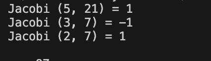
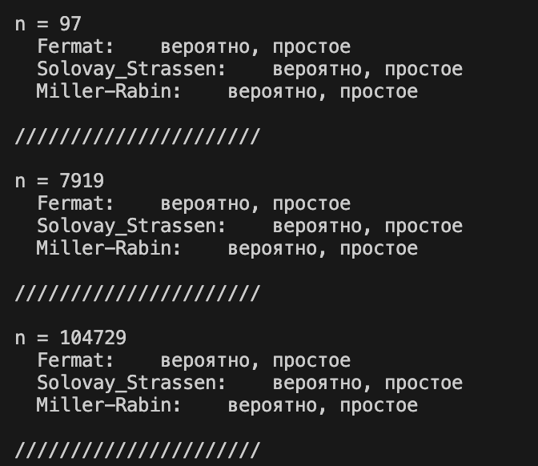
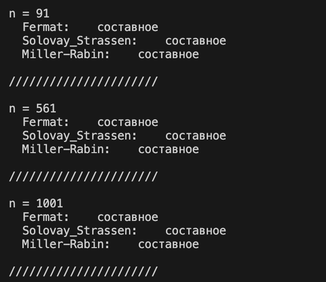

---
## Author
author:
  name: Мбах Наусси Джордан Вилфри
  degrees: BSc
  email: 1032265887@rudn.ru
  affiliation:
    - name: Российский университет дружбы народов им. П. Лумумбы
      country: Российская Федерация
      postal-code: 117198
      city: Москва
      address: ул. Миклухо-Маклая, д. 6
## Title
title: "Отчёт по лабораторной работе №5"
subtitle: "Вероятностные алгоритмы проверки чисел на простоту"
license: "CC BY"
abstract: |
  В работе изучены и реализованы на языке Python вероятностные алгоритмы проверки чисел на простоту: тест Ферма, тест Соловэя–Штрассена (с вычислением символа Якоби) и тест Миллера–Рабина. Корректность реализации проверена на простых числах 97, 7919, 104729 и составных числах 91, 561, 1001.
keywords: ["лабораторная работа", "проверка на простоту", "тест Ферма", "символ Якоби", "тест Соловэя–Штрассена", "тест Миллера–Рабина"]
---

# Цель работы

Изучить вероятностные алгоритмы проверки чисел на простоту и реализовать их программно.

# Задание

1. Реализовать алгоритм, реализующий тест Ферма.
2. Реализовать алгоритм вычисления символа Якоби.
3. Реализовать алгоритм, реализующий тест Соловэя–Штрассена.
4. Реализовать алгоритм, реализующий тест Миллера–Рабина.
5. Проверить результаты на простых и составных числах.

# Теоретическое введение

## Простые и составные числа

Пусть $a$ — целое число. Числа $\pm 1$, $\pm a$ называются *тривиальными делителями* числа $a$. Целое число $p \in \mathbb{Z}\setminus\{0\}$ называется *простым*, если оно не является делителем единицы и не имеет других делителей, кроме тривиальных. В противном случае число $p \in \mathbb{Z}\setminus\{-1, 0, 1\}$ называется *составным*. Например, числа $\pm 2, \pm 3, \pm 5, \pm 7, \pm 11, \pm 13, \pm 17, \pm 19, \pm 23, \pm 29$ являются простыми.

Пусть $m \in \mathbb{N}$, $m > 1$. Целые числа $a$ и $b$ называются *сравнимыми по модулю* $m$ (обозначается $a \equiv b \pmod m$), если разность $a - b$ делится на $m$. Эта процедура также называется нахождением остатка от целочисленного деления $a$ на $m$.

## Вероятностные алгоритмы

Проверка чисел на простоту является составной частью алгоритмов генерации простых чисел, применяемых в криптографии с открытым ключом. Алгоритмы проверки на простоту делятся на *вероятностные* и *детерминированные*.

*Детерминированный* алгоритм всегда действует по одной и той же схеме и гарантированно решает поставленную задачу (или не даёт никакого ответа). *Вероятностный* алгоритм использует генератор случайных чисел и не гарантирует точный ответ. Вероятностные алгоритмы в общем случае не менее эффективны, чем детерминированные.

Для проверки на простоту числа $n$ вероятностным алгоритмом выбирают случайное число $a$ ($1 < a < n$) и проверяют условия алгоритма (рис. [-@fig-scheme]):

- если число $n$ не проходит тест по основанию $a$, то алгоритм выдаёт результат «Число $n$ составное», и число $n$ **действительно** является составным;
- если число $n$ проходит тест по основанию $a$, то о простоте $n$ ничего нельзя сказать наверняка. Последовательно проведя ряд проверок для разных $a$ и получив для каждого ответ «Число $n$, вероятно, простое», можно утверждать, что $n$ — простое с вероятностью, близкой к 1. После $t$ независимых выполнений теста вероятность того, что составное число $n$ будет $t$ раз объявлено простым (вероятность ошибки), не превосходит $\dfrac{1}{2^t}$.

::: {#fig-scheme}

```{mermaid}
%%| fig-width: 100%
graph TD
    A[Выбрать случайное число a, 1 < a < n] --> B{Условие теста}
    B -->|Пройден| C[Число n прошло тест по основанию a]
    B -->|Не пройден| D[Число n не прошло тест по основанию a]
    C --> E[Число n, вероятно, простое]
    D --> F[Число n составное]
```

Схема вероятностного алгоритма проверки числа на простоту

:::

## Тест Ферма

Основан на малой теореме Ферма: для простого числа $p$ и произвольного числа $a$, $1 \le a \le p-1$, выполняется сравнение
$$a^{p-1} \equiv 1 \pmod p.$$

Следовательно, если для нечётного $n$ существует такое целое $a$, что $1 \le a < n$, $\gcd(a, n) = 1$ и $a^{n-1} \not\equiv 1 \pmod n$, то число $n$ составное.

**Алгоритм.** Вход: нечётное целое число $n \ge 5$. Выход: «Число $n$, вероятно, простое» или «Число $n$ составное».

1. Выбрать случайное целое число $a$, $2 \le a \le n-2$.
2. Вычислить $r \leftarrow a^{n-1} \pmod n$.
3. При $r = 1$ результат: «Число $n$, вероятно, простое». В противном случае результат: «Число $n$ составное».

На шаге 1 не рассматриваются числа $a = 1$ и $a = n-1$, поскольку $1^{n-1} \equiv 1 \pmod n$ для любого $n$ и $(n-1)^{n-1} \equiv (-1)^{n-1} \equiv 1 \pmod n$ для любого нечётного $n$.

## Символ Якоби

Пусть $m, n \in \mathbb{Z}$, где $n = p_1 p_2 \dots p_r$ и числа $p_i \ne 2$ простые (не обязательно различные). *Символ Якоби* $\left(\dfrac{m}{n}\right)$ определяется равенством
$$\left(\frac{m}{n}\right) = \left(\frac{m}{p_1}\right)\left(\frac{m}{p_2}\right)\dots\left(\frac{m}{p_r}\right).$$

**Алгоритм вычисления символа Якоби.** Вход: нечётное целое число $n \ge 3$, целое число $a$, $0 \le a < n$. Выход: символ Якоби $\left(\dfrac{a}{n}\right)$.

1. Положить $g \leftarrow 1$.
2. При $a = 0$ результат: 0.
3. При $a = 1$ результат: $g$.
4. Представить $a$ в виде $a = 2^k a_1$, где число $a_1$ нечётное.
5. При чётном $k$ положить $s \leftarrow 1$; при нечётном $k$ положить $s \leftarrow 1$, если $n \equiv \pm 1 \pmod 8$, и $s \leftarrow -1$, если $n \equiv \pm 3 \pmod 8$.
6. При $a_1 = 1$ результат: $g \cdot s$.
7. Если $n \equiv 3 \pmod 4$ и $a_1 \equiv 3 \pmod 4$, то $s \leftarrow -s$.
8. Положить $a \leftarrow n \pmod{a_1}$, $n \leftarrow a_1$, $g \leftarrow g \cdot s$ и вернуться на шаг 2.

## Тест Соловэя–Штрассена

Основан на критерии Эйлера: нечётное число $n$ является простым тогда и только тогда, когда для любого целого $a$, $1 \le a \le n-1$, взаимно простого с $n$, выполняется сравнение
$$a^{\frac{n-1}{2}} \equiv \left(\frac{a}{n}\right) \pmod n,$$
где $\left(\dfrac{a}{n}\right)$ — символ Якоби.

**Алгоритм.** Вход: нечётное целое число $n \ge 5$. Выход: «Число $n$, вероятно, простое» или «Число $n$ составное».

1. Выбрать случайное целое число $a$, $2 \le a \le n-2$.
2. Вычислить $r \leftarrow a^{\frac{n-1}{2}} \pmod n$.
3. При $r \ne 1$ и $r \ne n-1$ результат: «Число $n$ составное».
4. Вычислить символ Якоби $s \leftarrow \left(\dfrac{a}{n}\right)$.
5. При $r \not\equiv s \pmod n$ результат: «Число $n$ составное». В противном случае результат: «Число $n$, вероятно, простое».

## Тест Миллера–Рабина

На сегодняшний день для проверки чисел на простоту чаще всего используется тест Миллера–Рабина, основанный на следующем наблюдении. Пусть число $n$ нечётное и $n - 1 = 2^s r$, где $r$ — нечётное. Если $n$ простое, то для любого $a \ge 2$, взаимно простого с $n$, выполняется условие $a^{n-1} \equiv 1 \pmod n$, причём последовательность $a^r, a^{2r}, \dots, a^{2^{s}r}$ по модулю $n$ либо начинается с $1$, либо содержит $-1$.

**Алгоритм.** Вход: нечётное целое число $n \ge 5$. Выход: «Число $n$, вероятно, простое» или «Число $n$ составное».

1. Представить $n-1$ в виде $n - 1 = 2^s r$, где число $r$ нечётное.
2. Выбрать случайное целое число $a$, $2 \le a \le n-2$.
3. Вычислить $y \leftarrow a^r \pmod n$.
4. При $y \ne 1$ и $y \ne n-1$ выполнить следующие действия:
    1. положить $j \leftarrow 1$;
    2. пока $j \le s-1$ и $y \ne n-1$:
        1. положить $y \leftarrow y^2 \pmod n$;
        2. при $y = 1$ результат: «Число $n$ составное»;
        3. положить $j \leftarrow j + 1$;
    3. при $y \ne n-1$ результат: «Число $n$ составное».
5. Результат: «Число $n$, вероятно, простое».

# Выполнение лабораторной работы

Алгоритмы реализованы на языке Python (файл `lab5.py`). Для генерации случайного основания $a$ используется модуль `random`. Возведение в степень по модулю выполняется встроенной функцией `pow(a, e, n)`, которая использует быстрое возведение в степень и не вычисляет $a^e$ целиком.

## Тест Ферма

Функция `fermat_test(n)` выбирает случайное $a \in [2, n-2]$, вычисляет $r = a^{n-1} \bmod n$ и возвращает «вероятно, простое», если $r = 1$, иначе «составное».

```python
import random

# 1. Алгоритм, реализующий тест Ферма.
def fermat_test(n):
    a = random.randint(2, n-2)
    r = pow(a, n - 1, n)
    if r == 1:
        return "вероятно, простое"
    return "составное"
```

## Символ Якоби

Функция `jacobi(a, n)` строго следует шагам алгоритма: в цикле выделяется степень двойки $a = 2^k a_1$ (счётчик `k`), определяется знак `s` по правилам для множителя $\left(\frac{2}{n}\right)^k$ и по квадратичному закону взаимности, после чего пара $(a, n)$ заменяется на $(n \bmod a_1,\ a_1)$, а накопленный знак `g` умножается на `s`.

```python
# 2. Алгоритм вычисления символа Якоби.
def jacobi(a, n):
    g = 1
    while True:
        if a == 0:
            return 0
        if a == 1:
            return g

        k = 0
        a1 = a
        while a1 % 2 == 0:
            a1 //= 2
            k += 1

        if k % 2 == 0:
            s = 1
        elif n % 8 in (1, 7):
            s = 1
        else:
            s = -1

        if a1 == 1:
            return g * s

        if n % 4 == 3 and a1 % 4 == 3:
            s = -s

        a = n % a1
        n = a1
        g = g * s
```

## Тест Соловэя–Штрассена

Функция `solovay_strassen_test(n)` вычисляет $r = a^{(n-1)/2} \bmod n$. Если $r \notin \{1, n-1\}$, число составное. Иначе вычисляется символ Якоби $s$ и проверяется условие $r \equiv s \pmod n$ (отрицательное значение $s = -1$ приводится к $n - 1$ операцией `s % n`).

```python
# 3. Алгоритм, реализующий тест Соловэя-Штрассена.
def solovay_strassen_test(n):
    a = random.randint(2, n-2)
    r = pow(a, (n-1)//2, n)
    if r != 1 and r != n-1:
        return "составное"
    s = jacobi(a, n)
    if r != s % n:
        return "составное"
    return "вероятно, простое"
```

## Тест Миллера–Рабина

Функция `miller_rabin_test(n)` сначала раскладывает $n - 1 = 2^s r$ с нечётным $r$, затем вычисляет $y = a^r \bmod n$ и, если $y \ne \pm 1$, последовательно возводит $y$ в квадрат не более $s - 1$ раз в поисках значения $n - 1$. Появление $y = 1$ без предшествующего $-1$ означает нетривиальный квадратный корень из единицы, то есть составное число.

```python
# 4. Алгоритм, реализующий тест Миллера-Рабина.
def miller_rabin_test(n):
    s = 0
    r = n-1
    while r % 2 == 0:
        r //= 2
        s += 1

    a = random.randint(2, n-2)
    y = pow(a, r, n)

    if y != 1 and y != n-1:
        j = 1
        while j <= s-1 and y != n-1:
            y = (y*y) % n
            if y == 1:
                return "составное"
            j += 1
        if y != n-1:
            return "составное"

    return "вероятно, простое"
```

## Многократное повторение теста и контрольные примеры

Один запуск вероятностного теста по случайному основанию даёт лишь частичную информацию. Поэтому функция `repeat_test` запускает выбранный тест $t = 10$ раз (по умолчанию) и возвращает «составное», как только хотя бы один запуск обнаружил составное число. Для тестов Соловэя–Штрассена и Миллера–Рабина вероятность принять составное число за простое после $t$ повторений не превышает $2^{-t} \approx 0{,}001$.

```python
def repeat_test(test, n, t=10):
    for _ in range(t):
        if test(n) == "составное":
            return "составное"
    return "вероятно, простое"


print(f"Jacobi (5, 21) = {jacobi(5, 21)}")
print(f"Jacobi (3, 7) = {jacobi(3, 7)}")
print(f"Jacobi (2, 7) = {jacobi(2, 7)}")
print()

# primes: 97, 7919, 104729. composites: 91, 561, 1001
for n in [97, 7919, 104729, 91, 561, 1001]:
    print(f"n = {n}")
    print(f"  Fermat:    {repeat_test(fermat_test, n)}")
    print(f"  Solovay_Strassen:    {repeat_test(solovay_strassen_test, n)}")
    print(f"  Miller-Rabin:    {repeat_test(miller_rabin_test, n)}")
    print("\n//////////////////////\n")
```

В качестве контрольных данных выбраны простые числа $97$, $7919$ (1000-е простое) и $104729$ (10000-е простое), а также составные числа $91 = 7 \cdot 13$, $561 = 3 \cdot 11 \cdot 17$ (наименьшее число Кармайкла) и $1001 = 7 \cdot 11 \cdot 13$.

# Результаты

Сначала проверено вычисление символа Якоби на трёх примерах (рис. [-@fig-jacobi]).

{#fig-jacobi width=40%}

Значения проверены вручную:

- $\left(\frac{5}{21}\right) = \left(\frac{5}{3}\right)\left(\frac{5}{7}\right) = (-1)(-1) = 1$;
- $\left(\frac{3}{7}\right) = -1$, так как $3$ не является квадратичным вычетом по модулю $7$ (квадраты: $1, 2, 4$);
- $\left(\frac{2}{7}\right) = 1$, так как $7 \equiv -1 \pmod 8$ (действительно, $3^2 = 9 \equiv 2 \pmod 7$).

Затем три теста запущены на простых числах $97$, $7919$ и $104729$ (рис. [-@fig-prime]) и на составных числах $91$, $561$ и $1001$ (рис. [-@fig-composite]).

{#fig-prime width=60%}

{#fig-composite width=60%}

Сводные результаты (по 10 повторений каждого теста):

| $n$ | Тип | Ферма | Соловэй–Штрассен | Миллер–Рабин |
|:---:|:---:|:---:|:---:|:---:|
| 97 | простое | вероятно, простое | вероятно, простое | вероятно, простое |
| 7919 | простое | вероятно, простое | вероятно, простое | вероятно, простое |
| 104729 | простое | вероятно, простое | вероятно, простое | вероятно, простое |
| 91 | составное | составное | составное | составное |
| 561 | составное | составное | составное | составное |
| 1001 | составное | составное | составное | составное |

# Обсуждение результатов

- Для всех простых чисел ни один тест не выдал ошибочного ответа. Это ожидаемо: простое число проходит любой из тестов при любом основании $a$ (малая теорема Ферма, критерий Эйлера, свойства квадратных корней из единицы по простому модулю).
- Для составных чисел все три теста дали ответ «составное». Ответ «составное» всегда достоверен, так как найден свидетель составности. Ответ «вероятно, простое» достоверным не является.
- Число $561$ — число Кармайкла: $a^{560} \equiv 1 \pmod{561}$ для всех $a$, взаимно простых с $561$. Тест Ферма обнаруживает его составным только тогда, когда выбранное $a$ имеет общий делитель с $561$ (доля таких $a$ составляет около $43\%$). Вероятность пропустить $561$ за 10 попыток равна примерно $0{,}57^{10} \approx 0{,}4\%$, поэтому в данном запуске результат «составное» получен, но тест Ферма в принципе не имеет оценки вероятности ошибки $2^{-t}$ для чисел Кармайкла. Тесты Соловэя–Штрассена и Миллера–Рабина свободны от этого недостатка: для любого составного нечётного $n$ доля «лжесвидетелей» не превосходит $1/2$ (для Миллера–Рабина — не более $1/4$).
- Тест Соловэя–Штрассена требует вычисления символа Якоби, поэтому корректность этой вспомогательной функции критична для результата теста.
- Тест Миллера–Рабина не требует символа Якоби, использует только возведение в степень и возведения в квадрат по модулю, и на практике наиболее часто применяется в криптографии при генерации простых чисел.

# Выводы

В ходе лабораторной работы были изучены и реализованы на Python вероятностные алгоритмы проверки на простоту: тест Ферма, тест Соловэя–Штрассена вместе с вычислением символа Якоби и тест Миллера–Рабина. На контрольных примерах все тесты правильно определили простые числа $97$, $7919$, $104729$ и составные числа $91$, $561$, $1001$. Показано, что многократное повторение теста уменьшает вероятность ошибки как $2^{-t}$, а для чисел Кармайкла тест Ферма менее надёжен, чем тесты Соловэя–Штрассена и Миллера–Рабина.

# Список литературы {.unnumbered}

::: {#refs}
:::
