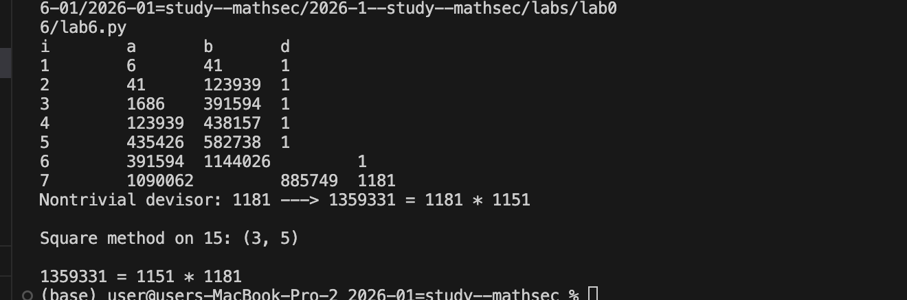

---
## Author
author:
  name: Мбах Наусси Джордан Вилфри
  degrees: BSc
  email: 1032265887@rudn.ru
  affiliation:
    - name: Российский университет дружбы народов им. П. Лумумбы
      country: Российская Федерация
      postal-code: 117198
      city: Москва
      address: ул. Миклухо-Маклая, д. 6
## Title
title: "Лабораторная работа 6"
subtitle: "Разложение чисел на множители"
license: CC BY
date: today
date-format: "YYYY-MM-DD"
---

# Информация

## Докладчик

:::::::::::::: {.columns align=center}
::: {.column width="70%"}

  * Мбах Наусси Джордан Вилфри
  * Студент 1 курса магистратуры
  * Группа НФИмд-01-26
  * Фундаментальная информатика и информационные технологии
  * Российский университет дружбы народов им. П. Лумумбы
  * [1032265887@rudn.ru](mailto:1032265887@rudn.ru)
  * <https://www.devjordan.com>

:::
::: {.column width="30%"}


:::
::::::::::::::

::: notes
- Поприветствовать аудиторию.
- Представиться кратко, даже если вас объявили.
:::

# Введение

## Цель работы

- Изучить задачу разложения составного числа на множители
- Реализовать на языке Python:
    - $p$-метод Полларда;
    - метод квадратов (разложение Ферма);
    - полное разложение на простые множители
- Разложить число $n = 1359331$

::: notes
- Сформулировать цель одним предложением.
- Трудность разложения лежит в основе криптосистем с открытым ключом.
:::

## Задача разложения

- Каноническое разложение: $n = p_1^{\alpha_1} p_2^{\alpha_2} \dots p_s^{\alpha_s}$
- На практике достаточно найти два нетривиальных сомножителя: $n = pq$, $1 \le p \le q < n$
- Полное разложение — рекурсивное применение к найденным множителям

::: notes
- p_i — попарно различные простые числа, альфа_i не меньше 1.
:::

# Теория

## $p$-метод Полларда: идея

- Отображение $f(x) \equiv x^2 + 5 \pmod n$, последовательность $x_{i+1} = f(x_i)$
- Последовательность зацикливается: «хвост» и цикл длины $O\left(\sqrt{\dfrac{\pi n}{8}}\right)$
- Два указателя: $a$ — на 1 шаг, $b$ — на 2 шага
- $d = \gcd(a - b, n)$ — делитель $n$

::: notes
- Если p — делитель n, то последовательность по модулю p зацикливается раньше.
- Тогда a ≡ b по модулю p, но не по модулю n, и НОД даёт делитель.
:::

## $p$-метод Полларда: алгоритм

1. $a \leftarrow c$, $b \leftarrow c$
2. $a \leftarrow f(a)$, $b \leftarrow f(f(b))$
3. $d \leftarrow \gcd(a - b, n)$
4. $1 < d < n$ → делитель $d$; $d = n$ → «не найден»; $d = 1$ → шаг 2

```{mermaid}
%%| fig-width: 100%
graph LR
    A[a = b = c] --> B["a = f(a), b = f(f(b))"]
    B --> C["d = gcd(|a-b|, n)"]
    C -->|"d = 1"| B
    C -->|"1 < d < n"| D[Делитель d]
```

::: notes
- Если d = n, повторяем с другим c.
:::

## Метод квадратов

- Теорема Ферма: $n = s^2 - t^2 = (s - t)(s + t)$
- Делителям $\ge \sqrt n$ соответствуют пары $(s, t)$
- Пример: $15 = 4^2 - 1^2 = 3 \cdot 5$ и $15 = 8^2 - 7^2 = 1 \cdot 15$
- Алгоритм: $s = \lceil \sqrt n \rceil, \dots$, пока $s^2 - n$ — полный квадрат

::: notes
- Быстро, когда множители близки к корню из n.
:::

# Реализация

## $p$-метод Полларда

```{.python code-line-numbers="2|3-5|6-8|9-10|11-14"}
def pollard_rho(n, c=1, show=False):
    f = lambda x: (x * x + 5) % n
    a, b, = c, c
    i = 0
    while True:
        i += 1
        a = f(a)
        b = f(f(b))
        d = gcd(abs(a-b), n)
        if show:
            print(f"{i}\t {a}\t {b}\t {d}")
        if d == n:
            return None
        if d > 1:
            return d
```

::: notes
- a — медленный указатель, b — быстрый.
- show=True печатает таблицу итераций.
- None означает, что нужно взять другое c.
:::

## Метод квадратов

```{.python code-line-numbers="2-4|5-6|7-9|10"}
def fermat_squares(n):
    s = isqrt(n)
    if s * s < n:
        s += 1
    while True:
        t2 = s * s - n
        t = isqrt(t2)
        if t * t == t2:
            return s - t, s + t
        s += 1
```

::: notes
- Стартуем с потолка корня из n.
- Если t2 — полный квадрат, возвращаем пару множителей.
:::

## Полное разложение (1/2)

```{.python code-line-numbers="1-9"}
def is_prime(n):
    if n < 2:
        return False

    i = 2
    while i * i <= n:
        if n % i == 0:
            return False
        i += 1
    return True
```

- Простота проверяется пробным делением до $\sqrt n$

::: notes
- Подходит только для небольших чисел.
- Для больших используют тест Миллера–Рабина из лабораторной 5.
:::

## Полное разложение (2/2)

```{.python code-line-numbers="2-5|6-7|8-10|12-17"}
def factorize(n):
    if n == 1:
        return []
    if is_prime(n):
        return [n]
    if n % 2 == 0:
        return [2] + factorize(n // 2)
    r = isqrt(n)
    if r * r == n:
        return sorted(factorize(r) * 2)

    c = 1
    while True:
        d = pollard_rho(n, c)
        if d:
            return sorted(factorize(d) + factorize(n // d))
        c += 1
```

::: notes
- Рекурсия: простое число, чётное, полный квадрат, иначе метод Полларда.
- При неудаче берём следующее c.
:::

## Запуск программы

```{.python code-line-numbers="1-2|4-6|8|10-11"}
c, n = 1, 1359331

print("i\t a\t b\t d")
d = pollard_rho(n, c, show=True)
print(f"Nontrivial devisor: {d} ---> {n} = {d} * {n//d}")

print(f"\nSquare method on 15: {fermat_squares(15)}")

n = 1359331
print(f"\n{n} =", " * ".join(map(str, factorize(n))))
```

::: notes
- Три действия: Поллард с таблицей, метод квадратов на 15, полное разложение.
:::

# Демонстрация

## Результат работы программы

{width=75%}

::: notes
- Показать таблицу итераций, метод квадратов на 15 и итоговое разложение.
:::

## Таблица $p$-метода Полларда

| $i$ | $a$ | $b$ | $d$ |
|:---:|:---:|:---:|:---:|
| 1 | 6 | 41 | 1 |
| 2 | 41 | 123939 | 1 |
| 3 | 1686 | 391594 | 1 |
| 4 | 123939 | 438157 | 1 |
| 5 | 435426 | 582738 | 1 |
| 6 | 391594 | 1144026 | 1 |
| 7 | 1090062 | 885749 | **1181** |

::: notes
- Таблица совпадает с примером из методических указаний.
- На 7-й итерации найден делитель 1181.
:::

## Разложение

- $p$-метод Полларда: $d = 1181$ за 7 итераций
- $1359331 = 1181 \cdot 1151$
- Метод квадратов: $15 = 3 \cdot 5$ ($s = 4$, $t = 1$)
- `factorize`: $1359331 = 1151 \cdot 1181$ — оба множителя простые

::: notes
- Проверка: 1181 · 1151 = 1359331.
:::

# Заключение

## Выводы

- Реализованы $p$-метод Полларда, метод квадратов и полное разложение на простые множители
- Число $1359331$ разложено за 7 итераций: $1151 \cdot 1181$
- Результаты совпали с примером из методических указаний
- Трудность разложения лежит в основе криптосистем с открытым ключом

::: notes
- Повторить главный вывод одним предложением.
- Готов ответить на вопросы.
:::
