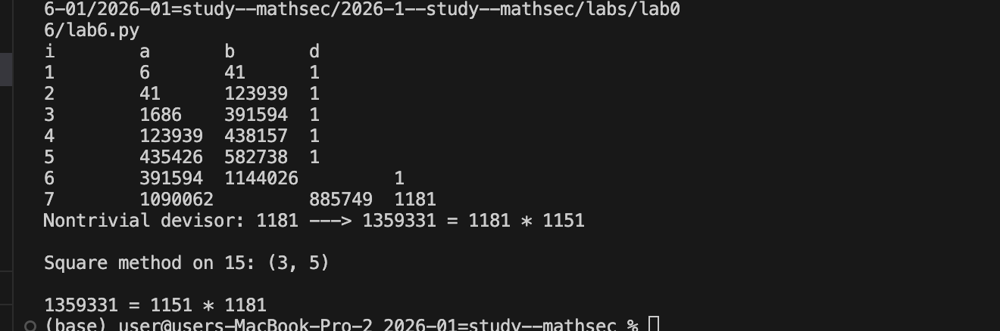

---
## Author
author:
  name: Мбах Наусси Джордан Вилфри
  degrees: BSc
  email: 1032265887@rudn.ru
  affiliation:
    - name: Российский университет дружбы народов им. П. Лумумбы
      country: Российская Федерация
      postal-code: 117198
      city: Москва
      address: ул. Миклухо-Маклая, д. 6
## Title
title: "Отчёт по лабораторной работе №6"
subtitle: "Разложение чисел на множители"
license: "CC BY"
abstract: |
  В работе изучена задача разложения составного числа на множители и реализованы на языке Python $p$-метод Полларда и метод квадратов (теорема Ферма о разложении). На основе этих методов написана рекурсивная функция полного разложения числа на простые множители. С её помощью число $n = 1359331$ разложено в произведение $1151 \cdot 1181$.
keywords: ["лабораторная работа", "разложение на множители", "p-метод Полларда", "метод квадратов", "теорема Ферма"]
---

# Цель работы

Изучить задачу разложения составного числа на множители и реализовать программно $p$-метод Полларда и метод квадратов.

# Задание

1. Реализовать $p$-метод Полларда.
2. Реализовать метод квадратов (разложение Ферма).
3. Разложить на множители число, выданное преподавателем.

# Теоретическое введение

## Задача разложения на множители

Задача разложения на множители — одна из первых задач, использованных для построения криптосистем с открытым ключом.

*Задача разложения составного числа на множители* формулируется следующим образом: для данного положительного целого числа $n$ найти его каноническое разложение
$$n = p_1^{\alpha_1} p_2^{\alpha_2} \dots p_s^{\alpha_s},$$
где $p_i$ — попарно различные простые числа, $\alpha_i \ge 1$.

На практике необязательно находить каноническое разложение числа $n$. Достаточно найти его разложение на два *нетривиальных сомножителя*: $n = pq$, $1 \le p \le q < n$. Далее задача разложения понимается именно в этом смысле. Полное разложение получается рекурсивным применением такого разбиения к найденным множителям.

## $p$-метод Полларда

Пусть $n$ — нечётное составное число, $S = \{0, 1, \dots, n-1\}$ и $f\colon S \to S$ — случайное отображение, обладающее сжимающими свойствами, например $f(x) \equiv x^2 + 1 \pmod n$. Выбирается случайный элемент $x_0 \in S$ и строится последовательность $x_0, x_1, x_2, \dots$, определяемая рекуррентным соотношением
$$x_{i+1} = f(x_i), \quad i \ge 0,$$
до тех пор, пока не найдутся такие числа $i, j$, что $i < j$ и $x_i = x_j$. Поскольку множество $S$ конечно, такие индексы существуют (последовательность «зацикливается»). Последовательность $\{x_i\}$ состоит из «хвоста» $x_0, x_1, \dots, x_{i-1}$ длины $O\left(\sqrt{\dfrac{\pi n}{8}}\right)$ и цикла $x_i = x_j, x_{i+1}, \dots, x_{j-1}$ той же длины.

**Алгоритм, реализующий $p$-метод Полларда.** Вход: число $n$, начальное значение $c$, функция $f$, обладающая сжимающими свойствами. Выход: нетривиальный делитель числа $n$.

1. Положить $a \leftarrow c$, $b \leftarrow c$.
2. Вычислить $a \leftarrow f(a) \pmod n$, $b \leftarrow f(f(b)) \pmod n$ (рис. [-@fig-rho]).
3. Найти $d \leftarrow \gcd(a - b, n)$.
4. Если $1 < d < n$, то положить $p \leftarrow d$ и результат: $p$. При $d = n$ результат: «Делитель не найден»; при $d = 1$ вернуться на шаг 2.

::: {#fig-rho}

```{mermaid}
%%| fig-width: 100%
graph TD
    A[a = c, b = c] --> B["a = f(a), b = f(f(b))"]
    B --> C["d = gcd(|a - b|, n)"]
    C --> D{d}
    D -->|"d = 1"| B
    D -->|"1 < d < n"| E[Делитель d найден]
    D -->|"d = n"| F[Делитель не найден]
```

Блок-схема $p$-метода Полларда

:::

Идея метода: если $p$ — неизвестный простой делитель $n$, то последовательность $x_i \bmod p$ зацикливается быстрее, чем $x_i \bmod n$. В момент, когда $a \equiv b \pmod p$, но $a \not\equiv b \pmod n$, число $\gcd(a - b, n)$ кратно $p$ и является нетривиальным делителем $n$. Для вычисления используются два указателя: $a$ движется на один шаг, а $b$ — на два шага за итерацию (метод «черепахи и зайца»), поэтому хранить всю последовательность не требуется.

## Метод квадратов (теорема Ферма о разложении)

Для любого положительного нечётного числа $n$ существует взаимно однозначное соответствие между множеством делителей числа $n$, не меньших $\sqrt n$, и множеством пар $\{s, t\}$ таких неотрицательных целых чисел, что
$$n = s^2 - t^2 = (s - t)(s + t).$$

Пример: у числа $15$ два делителя, не меньших $\sqrt{15}$, — это $5$ и $15$. Получаем два представления:

1. $15 = 3 \cdot 5$, откуда $s = 4$, $t = 1$ и $15 = 4^2 - 1^2$;
2. $15 = 1 \cdot 15$, откуда $s = 8$, $t = 7$ и $15 = 8^2 - 7^2$.

Поэтому для разложения достаточно перебирать $s$, начиная с $\lceil \sqrt n \rceil$, пока разность $s^2 - n$ не окажется полным квадратом $t^2$. Тогда $n = (s - t)(s + t)$. Метод особенно эффективен, когда множители $n$ близки к $\sqrt n$.

# Выполнение лабораторной работы

Алгоритмы реализованы на языке Python (файл `lab6.py`). Используются функции `gcd` и `isqrt` из модуля `math`; `isqrt` вычисляет целую часть квадратного корня без потери точности на больших числах.

## $p$-метод Полларда

Функция `pollard_rho(n, c, show)` использует отображение $f(x) = x^2 + 5 \pmod n$ (как в примере из методических указаний) и начальное значение $a = b = c$. На каждой итерации $a$ сдвигается на один шаг, $b$ — на два, вычисляется $d = \gcd(|a - b|, n)$. При $d = n$ возвращается `None` (делитель не найден), при $d > 1$ — делитель $d$. Параметр `show=True` выводит таблицу значений $i$, $a$, $b$, $d$.

```python
from math import gcd, isqrt

def pollard_rho(n, c=1, show=False):
    f = lambda x: (x * x + 5) % n
    a, b, = c, c
    i = 0
    while True:
        i += 1
        a = f(a)
        b = f(f(b))
        d = gcd(abs(a-b), n)
        if show:
            print(f"{i}\t {a}\t {b}\t {d}")
        if d == n:
            return None
        if d > 1:
            return d
```

## Метод квадратов

Функция `fermat_squares(n)` стартует с $s = \lceil \sqrt n \rceil$ (`isqrt` округляет вниз, поэтому при $s^2 < n$ значение увеличивается на единицу). Для каждого $s$ вычисляется $t^2 = s^2 - n$ и проверяется, является ли оно полным квадратом. Как только $t^2$ — полный квадрат, возвращается пара множителей $(s - t,\ s + t)$.

```python
def fermat_squares(n):
    s = isqrt(n)
    if s * s < n:
        s += 1
    while True:
        t2 = s * s - n
        t = isqrt(t2)
        if t * t == t2:
            return s - t, s + t
        s += 1
```

## Полное разложение на простые множители

Вспомогательная функция `is_prime(n)` проверяет простоту пробным делением на все $i \le \sqrt n$. Функция `factorize(n)` возвращает отсортированный список простых множителей. Работает она рекурсивно:

1. $n = 1$ → пустой список;
2. $n$ простое → список $[n]$;
3. $n$ чётное → множитель $2$ и разложение $n/2$ (так как $p$-метод рассчитан на нечётные числа);
4. $n$ — полный квадрат → дважды разложение $\sqrt n$;
5. иначе $p$-метод Полларда подбирает делитель $d$ при $c = 1, 2, 3, \dots$ (при неудаче с очередным $c$ берётся следующее начальное значение), и разложение продолжается для $d$ и $n/d$.

```python
def is_prime(n):
    if n < 2:
        return False

    i = 2
    while i * i <= n:
        if n % i == 0:
            return False
        i += 1
    return True

def factorize(n):
    if n == 1:
        return []
    if is_prime(n):
        return [n]
    if n % 2 == 0:
        return [2] + factorize(n // 2)
    r = isqrt(n)
    if r * r == n:
        return sorted(factorize(r) * 2)

    c = 1
    while True:
        d = pollard_rho(n, c)
        if d:
            return sorted(factorize(d) + factorize(n // d))
        c += 1
```

## Запуск программы

В основной части программы выполняются три действия: $p$-метод Полларда для $n = 1359331$ с $c = 1$ и выводом таблицы, метод квадратов для $n = 15$ (пример из теории) и полное разложение числа $1359331$.

```python
# execution
c, n = 1, 1359331

print("i\t a\t b\t d")
d = pollard_rho(n, c, show=True)
print(f"Nontrivial devisor: {d} ---> {n} = {d} * {n//d}")

print(f"\nSquare method on 15: {fermat_squares(15)}")

n = 1359331
print(f"\n{n} =", " * ".join(map(str, factorize(n))))
```

# Результаты

Результат работы программы показан на рис. [-@fig-result].

{#fig-result width=90%}

## $p$-метод Полларда для $n = 1359331$

При $c = 1$ и $f(x) = x^2 + 5 \pmod n$ получена следующая таблица:

| $i$ | $a$ | $b$ | $d = \gcd(a - b, n)$ |
|:---:|:---:|:---:|:---:|
| 1 | 6 | 41 | 1 |
| 2 | 41 | 123939 | 1 |
| 3 | 1686 | 391594 | 1 |
| 4 | 123939 | 438157 | 1 |
| 5 | 435426 | 582738 | 1 |
| 6 | 391594 | 1144026 | 1 |
| 7 | 1090062 | 885749 | 1181 |

: Работа $p$-метода Полларда для $n = 1359331$, $c = 1$ {#tbl-rho}

Значения таблицы [-@tbl-rho] полностью совпадают с примером из методических указаний. На 7-й итерации найден нетривиальный делитель $d = 1181$, откуда $1359331 = 1181 \cdot 1151$. Проверка: $1181 \cdot 1151 = 1181000 + 178331 = 1359331$.

## Метод квадратов для $n = 15$

Функция `fermat_squares(15)` вернула пару $(3, 5)$. Это соответствует первому из двух представлений из теории: начиная с $s = \lceil \sqrt{15} \rceil = 4$, получаем $t^2 = 16 - 15 = 1$, $t = 1$, откуда $15 = (4 - 1)(4 + 1) = 3 \cdot 5$. Второе представление ($s = 8$, $t = 7$, множители $1$ и $15$) тривиально и поиск на нём не доходит, так как первое найдено раньше.

## Полное разложение

Функция `factorize(1359331)` вернула
$$1359331 = 1151 \cdot 1181.$$
Оба множителя простые, поэтому это каноническое разложение числа $n$.

# Обсуждение результатов

- $p$-метод Полларда нашёл делитель всего за 7 итераций, что намного меньше $\sqrt n \approx 1166$ проверок пробным делением и согласуется с оценкой длины «хвоста» и цикла порядка $\sqrt{p}$, где $p$ — наименьший простой делитель.
- Для $n = 1359331$ делитель $1181$ нашёлся при $c = 1$. В общем случае возможен выход $d = n$ (последовательности по модулям всех простых делителей зациклились одновременно); тогда метод нужно повторить с другим начальным значением $c$ или другой функцией $f$. Именно так организован цикл в функции `factorize`.
- Метод квадратов быстро работает, когда множители близки друг к другу (как $3$ и $5$ у числа $15$), а число шагов растёт, когда делители сильно различаются. Для $n = 1359331$ множители $1151$ и $1181$ близки к $\sqrt n$, поэтому метод Ферма также быстро нашёл бы разложение.
- Проверка простоты в функции `is_prime` реализована пробным делением и годится только для небольших чисел. Для больших чисел в криптографии вместо неё используются вероятностные тесты (лабораторная работа №5), например тест Миллера–Рабина.
- Трудность задачи разложения на множители для больших $n$ лежит в основе криптосистем с открытым ключом, таких как RSA.

# Выводы

В ходе лабораторной работы были изучены и реализованы на Python $p$-метод Полларда и метод квадратов (теорема Ферма о разложении), а также рекурсивная функция полного разложения числа на простые множители. С помощью $p$-метода Полларда число $1359331$ разложено на множители за 7 итераций: $1359331 = 1151 \cdot 1181$. Результат таблицы совпал с примером из методических указаний, а метод квадратов на числе $15$ дал разложение $3 \cdot 5$.

# Список литературы {.unnumbered}

::: {#refs}
:::
